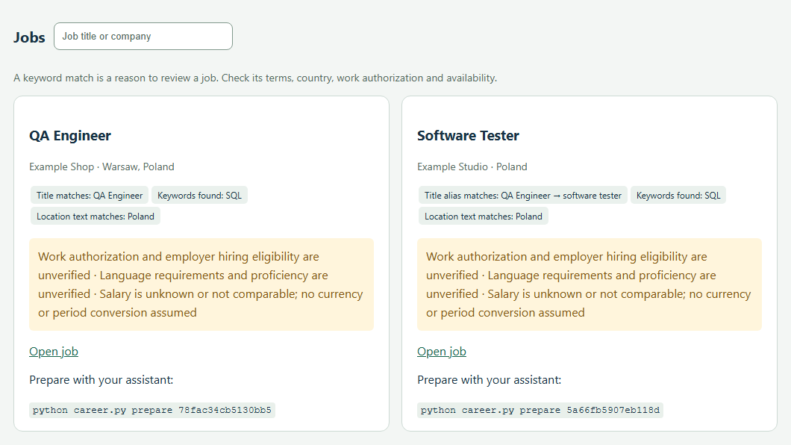

# Career Starter

**English** · [Українська](README.uk.md) · [](https://github.com/i5adovyi/career-starter/actions/workflows/ci.yml)

A local job-search workspace for use with Codex or Claude Code. Add your CV,
complete a short onboarding conversation, and get job leads, a learning plan
and tailored CVs with a mandatory natural-language review.

## Demo with a fictional CV

> “Used SQL queries to compare order totals with payment records.” — Ellen Example

Ellen is looking for a QA Engineer role in Poland. We imported two fictional
vacancies. The portal picked up both the exact title and *Software Tester* as a
related title. Each card shows why it matched and which hiring conditions still need checking.



Both postings ask for SQL and one also asks for Python. With three hours a week,
Ellen's plan gives her 90 minutes to test a SQL join against hand-calculated totals
and 90 minutes to try a Python exercise. [Try it with your own CV](#get-started).

## What works today

It supports different professions, first jobs, career changes and returning
after a break. Your answers define the profile and criteria. There is no
preset profession, salary threshold or “ideal candidate”.

The working cycle is **CV and confirmed preferences → real job leads →
focused practice → tailored CV → humanization and fact review → your approval**.
The goal is a useful next step: a job worth reviewing, a practical learning task,
or an application you can confidently discuss.

Use a separate project folder for each candidate. The reusable code and
instructions can be shared; the candidate's profile, documents and progress
stay in that folder's private `local/` directory.

| Part | What it does |
|---|---|
| Portal | Four-step CV onboarding, saved drafts, job search and results, learning plan, application status, English/Ukrainian interface, light/dark themes. |
| Search | Fetches configured public feeds and matches locally, including known title synonyms and translations in English, Ukrainian, German, Polish and French. Shows match reasons and unresolved conditions. |
| Learning | Compares CV evidence and stated skills with current job requirements; proposes up to three topics, practical tasks and checks within the weekly budget. Preserves personal edits. |
| Codex / Claude Code | Guides decisions, interprets requirements, writes tailored CVs and optional cover letters, performs the mandatory humanization and factual review. |
| Candidate | Confirms their facts and preferences, reviews the final writing, personally approves the CV and decides whether to submit it. |

The portal and assistant use the same local files. The Python runtime has no
embedded language model; it does not write a finished tailored CV or submit
applications. Search and learning use finite local vocabularies, with explicit
unknowns for the assistant and candidate to resolve.

## Get started

You need Python 3.10 or newer. The portal and Python tool use only the standard
library and need no API key. Job-feed searches require internet access.
Use Codex or Claude Code later to tailor your CV, review writing and refine
your learning plan.

The portal handles onboarding and job searches. Codex or Claude Code can also
conduct onboarding conversationally, write and edit your CV, and refine the
learning plan. There is no language model embedded in Python.

1. Download a clean copy and extract it into its own folder.
2. Run `python career.py portal` from that folder. On Windows you can also open
   `start.cmd`; on macOS/Linux run `sh start.sh`.
3. In the browser, upload a CV or paste its text. Complete the four steps:
   **Your CV → Your next role → Skills & learning → Review & search**.
4. Review the extracted text and your answers, tick the confirmation box, and
   choose **Confirm & find jobs**. The portal saves your profile, searches the
   selected public sources and creates a learning plan from your CV and the
   requirements of the jobs it finds.

The default address is `http://127.0.0.1:8766/`. To keep the browser closed or
choose a different local port, use
`python career.py portal --no-open --port 8766`. Keep the server process running
while using the portal.

Answers save automatically to `local/onboarding-draft.json`. Reloading resumes
the saved step. Uploads stay under `local/imports/`; the portal does not send
your CV to job feeds. If PDF/DOCX extraction fails, the original remains saved
and you can paste its text. A failed search preserves your profile and can be
retried using **Find jobs / Search again**.

For guided onboarding or help with the next steps, open the folder in Codex or
Claude Code and ask:

   > Read AGENTS.md and guide me through onboarding. Here is my CV. Ask only
   > what is missing for the search, confirm my facts and criteria with me,
   > find relevant jobs and create a realistic learning plan.

The assistant should carry out the work. If you do not have a CV yet, start
with a description of your experience, education or desired work.

To start manually:

```text
python career.py init
python career.py import-cv "PATH_TO_CV"
python career.py status
python career.py portal
```

Use `python3` instead of `python` if that is your system's Python command.
Markdown, TXT and DOCX are supported. PDF extraction requires `pdftotext`;
a scanned PDF may need the assistant's document-reading tools or a text copy.
An extraction failure does not mean you have no experience.

## Language

The portal opens in **English** by default. Use **EN / УК** at the top right to
switch between English and Ukrainian. Your choice is remembered in that browser
and survives a page reload. Job descriptions and saved documents keep their
original language.

Use the **Dark theme / Light theme** button beside the language switch to change
appearance. The first visit follows your system theme; an explicit choice is
saved in that browser and applied before the page is drawn.

Assistant onboarding also starts in English unless you request another language
or write in Ukrainian. The portal's onboarding prompt follows its selected
language. Choose your conversation and learning-plan language with the assistant;
confirm the CV language separately for each application.

The portal's questions and controls follow its selected language. Choose the
learning-plan language in step three. Tailored CV language is agreed separately
with your assistant.

## Onboarding

The portal asks about your target roles, locations, work arrangement, languages,
skills, preferences and available learning time. It shows the text and answers
for your confirmation before creating a profile. It does not infer your skills
or achievements from a vacancy or independently verify your CV claims.

If you prefer conversational onboarding, your assistant reads the CV,
summarizes the facts and asks a few questions:
what work to look for, where and in which working arrangement, working languages,
important conditions, and realistic weekly learning time. If your direction is
unclear, it helps compare options against your experience and actual vacancies.

You do not need to explain a career break or share family or other sensitive
details. You decide whether to include them. Unknown information stays unknown;
the assistant must not invent experience, tools, achievements or language levels.

After confirmation, the portal creates your private profile, master CV and
evidence ledger. An assistant-led workflow can create the same artifacts and
use this command:

```text
python career.py onboard --profile local/profile-input.json
```

See [templates/profile.example.json](templates/profile.example.json) for the
format. It contains synthetic examples to replace with your own information.
`confirmed` becomes `true` only after you confirm the profile.

## Search and learn

```text
python career.py search
python career.py learn
python career.py status
python career.py portal
```

Search reads configured public sources: Arbeitnow, Remotive and selected
Greenhouse or Lever company boards. These cover part of the market. Your
assistant can add available web research or jobs you found yourself. Sources
that fail must be reported as failures.

Title matching includes a local vocabulary of synonyms and translations in
English, Ukrainian, German, Polish and French. For example, `Customer Support`
can find `Kundensupport` and `Customer Service` titles. Each result explains
which title matched. Unknown occupations still use the literal title; add
alternative names to your target roles when the vocabulary does not cover them.
Related but distinct occupations are not automatically interchangeable.

Check results against the actual description: “remote” does not always mean
worldwide hiring, and matching words do not establish suitability. Unknown
salary, work authorization or requirements do not become confirmed matches.

Use `python career.py import-jobs PATH` to add an external list. The format and
source capabilities are documented in [docs/SOURCES.md](docs/SOURCES.md); your
assistant can prepare the file from reviewed descriptions.

The learning plan lives in `local/learning-plan.md`. It compares your CV and
confirmed skills with recognized requirements in the found job descriptions,
then selects up to three priorities within your weekly time budget. Topics
include CV evidence, quoted job requirements and links, a practical exercise,
an output, a completion check and a first step. Your chosen learning goals also
influence the priorities. A skill absent from the CV is **unknown**, not proof
that you lack it; the plan starts with an assessment in that case.

This runs locally without an AI service. The vocabulary and exercise library
are finite; unrecognized requirements and unavailable job evidence are reported
honestly. Your assistant can interpret specialized requirements and refine the
plan. Training does not become professional experience or a verified qualification.

An untouched generated plan updates after a new portal search or `learn` run.
Your manual edits and older plans are preserved; the portal shows an updated
suggestion separately for you and your assistant to review. The supporting
analysis is saved in `local/learning-plan.json`.

Search runs when invoked. Background monitoring or a schedule needs separate
setup at your request.

## Tailored CV: facts, natural writing, your decision

For a selected job, ask:

> Prepare an application for JOB_ID. Map its requirements to my confirmed facts,
> tailor my CV, perform humanization and check the facts again. Show me the
> final text to review.

The assistant runs `prepare`, works on a CV copy, and saves the final `CV.md`
with its evidence mapping and review. Rephrasing is allowed; facts from a job
description do not become your experience.

Humanization is mandatory: remove formulaic phrases, exaggerated claims and
unnatural wording while preserving your voice. You should be able to discuss
what it says naturally in an interview. Facts are checked again after editing.
This is not a promise about AI-detector results.

The assistant's technical cycle:

```text
python career.py prepare JOB_ID
python career.py hash JOB_ID
python career.py review JOB_ID --review local/applications/JOB_ID/review-input.json
```

The review format is in [templates/review.example.json](templates/review.example.json).
After editing, the assistant obtains `cv_sha256` and `bundle_sha256` with `hash`,
reviews that exact version, and records both values in the review. Every
substantive CV line, including your name and job headings, must map to confirmed
facts. Standard section headings such as “Experience” and “Education” are exempt.
Changes require another review. Automated checks verify coverage and version
consistency; they cannot establish truth or writing quality on their own.

After reading the final text, run this command **personally**:

```text
python career.py approve JOB_ID
```

It asks you to confirm the displayed version. The assistant must not do this
step on your behalf. Once approved, export it:

```text
python career.py export JOB_ID
```

Markdown and HTML versions appear in `local/exports/`. Open the HTML in a browser,
check its appearance and print to PDF if needed. Export covers the CV; review
any cover letter separately. The project does not send applications or contact
employers.

After an actual submission or interview, ask the assistant to record the event.
For example, `python career.py stage JOB_ID applied --note "Submitted by candidate"`
only updates history. `python career.py check JOB_ID` checks whether the review
and your approval are still current.

## Private data and public copies

All personal files belong in `local/`, which is excluded from Git. Public code,
instructions and templates must not contain CVs, contact details, private notes,
application history or credentials.

```text
career-starter/
  AGENTS.md                 shared assistant instructions
  CLAUDE.md                 entry point for Claude Code
  career.py                 command-line entry point
  careerkit/                runtime, portal and local workflows
  workflows/                onboarding, search, learning, CV, humanization
  templates/                synthetic examples only
  local/                    your data; never publish
    inbox/                  CVs to import
    imports/                preserved originals and extracted text
    profile-input.json      confirmed criteria
    profile.json            active profile after onboarding
    onboarding-draft.json   unfinished, unconfirmed portal answers
    master.md               master CV
    evidence.json           confirmed facts
    jobs.json               search results, source status and match reasons
    applications/           jobs, drafts and reviews
    learning-plan.md        current plan and personal notes
    learning-plan.json      generated CV/requirement analysis
    learning-plan-state.json  hashes and suggested-plan location
    learning-plan.suggested*.md  proposed updates when the plan has edits
    exports/                finished CVs
```

`profile.json` is the active profile; `profile-input.json` is an input to
assistant-led onboarding. A saved portal draft is not a confirmed profile.
Generated learning analysis is not proof of skill, and an exported CV is not
evidence that an application was sent.

Local storage does not mean the AI runs offline. Text your assistant reads is
processed according to your Codex or Claude Code settings. Public job searches
must not send your CV to the feeds.

To share the tool itself:

```text
python career.py check-public
python career.py package
```

Inspect the generated package before sharing. Do not manually ZIP the entire
workspace: it may already contain personal data. `.gitignore` does not remove
files previously committed to Git history. Start a clean public copy without
private history.

## Working in a new assistant session

Open the Career Starter folder itself, read [AGENTS.md](AGENTS.md), and run
`python career.py status`. Claude Code starts from [CLAUDE.md](CLAUDE.md), which
points to the same shared rules. Existing files are the continuity between
sessions; an assistant must inspect the relevant saved state before asking you
to repeat onboarding or recreating documents.

For an existing candidate, a useful starting request is:

> Read AGENTS.md and check the saved state. Tell me where we stopped and carry
> out the next useful step. Preserve my CV, application drafts and learning notes.

For development, first check `git status --short` and the relevant diff in this
repository. Work on the requested feature without running onboarding or searches
against a real candidate as a test. This project is self-contained; if it is
inside another workspace, use the Git repository containing `career.py`.

### Code map

Python 3.10+ and the standard library run the whole application. The browser UI
is HTML/CSS/JavaScript served by Python; there is no Node build or database setup.

| File | Responsibility |
|---|---|
| `career.py` | CLI commands and project root; data belongs beside this script, regardless of the shell's working directory. |
| `careerkit/workspace.py` | Private paths, atomic writes, CV import, profile/evidence validation and onboarding. |
| `careerkit/onboarding.py` | Portal drafts, uploads, confirmation and background search orchestration. |
| `careerkit/portal.py` | Local HTTP server, protected routes, dashboard, inline UI and translations. |
| `careerkit/search.py` | Feed adapters, cache, imports, ranking and source/error reporting. |
| `careerkit/roles.py` | Curated title aliases, translations and role qualifiers. |
| `careerkit/learning.py` | CV/requirement analysis, priorities, exercises and preservation of edited plans. |
| `careerkit/cv.py` | Application preparation, review, version-bound approval, export and event history. |
| `careerkit/release.py` + `PUBLIC_FILES.json` | Public-content checks and explicit distribution allowlist. |
| `tests/` | Standard-library unit, integration and CLI journey tests using synthetic data. |

Use `python career.py --help` for supported commands. Run checks appropriate to
the change; the full suite and public-content check are:

```text
python -m unittest discover -s tests -v
python career.py check-public
```

For a changed portal flow, also exercise it in a separate synthetic workspace.
Add new distributable files to `PUBLIC_FILES.json`; keep candidate files outside
that manifest. Keep both READMEs and the relevant workflow instructions aligned
with behavior. [docs/VERIFICATION.md](docs/VERIFICATION.md) records completed
checks and limitations, not a guarantee that later changes passed them.

## If something stops

- **CV could not be read:** check the import result, provide text/DOCX or use the
  assistant's document-reading tools.
- **No jobs:** check source statuses and criteria. Broaden locations or roles
  only if they suit you.
- **Export blocked:** the assistant must fix the specific evidence or review
  gap, then you approve the current version. Do not disable the gate.
- **Unclear command:** run `python career.py --help`.

The full assistant workflow is in [AGENTS.md](AGENTS.md). Verification results
and current limits are in [docs/VERIFICATION.md](docs/VERIFICATION.md).
