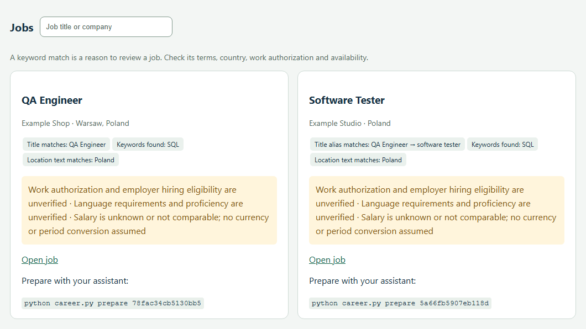

# Career Starter

[English](README.md) · **Українська** · [](https://github.com/i5adovyi/career-starter/actions/workflows/ci.yml)

Локальний помічник для пошуку роботи разом із Codex або Claude Code:
додаєте CV, проходите короткий онбординг і отримуєте пошук вакансій, план
навчання та адаптовані резюме з обов'язковою перевіркою природності тексту.

## Демо на вигаданому CV

**[Спробуйте інтерактивне демо Еллен](https://i5adovyi.github.io/career-starter/?lang=uk)**. Порівняйте дві вакансії, подивіться, які умови Еллен ще має уточнити, і відкрийте її план на три години практики із SQL та Python. Для демо не потрібні вхід чи завантаження CV. Щоб працювати зі своїм резюме, [запустіть портал локально](#почати).

> «Звіряла суми замовлень із записами про оплату за допомогою SQL-запитів». — Еллен Екзампл

Еллен шукає роботу QA Engineer у Польщі. Для демо ми імпортували дві вигадані
вакансії. Портал знайшов точний збіг назви й розпізнав *Software Tester* як споріднену
посаду. На кожній картці видно, чому вакансія підійшла для розгляду та які умови ще треба уточнити.



В обох вакансіях потрібен SQL, в одній також згадано Python. Еллен має три години
на тиждень. План відводить 90 хвилин на перевірку SQL JOIN за підрахованими вручну
сумами й 90 хвилин на практичну вправу з Python. [Спробуйте зі своїм CV](#почати).

## Що вже працює

Підходить для різних професій, першої роботи, зміни напряму та повернення після
перерви. Профіль і критерії формуються з ваших відповідей. Готового «правильного
кандидата», зарплатної планки або професії за замовчуванням тут немає.

Робочий цикл: **CV і підтверджені побажання → реальні вакансії →
цільова практика → адаптоване CV → humanization і перевірка фактів →
ваше підтвердження**. Мета — корисний наступний крок: вакансія для розгляду,
практичне навчальне завдання або заявка, зміст якої ви можете впевнено пояснити.

Для кожного кандидата використовуйте окрему теку проєкту. Кодом та інструкціями
можна ділитися; профіль, документи й прогрес кандидата залишаються у приватній
теці `local/` всередині його копії.

| Частина | Що робить |
|---|---|
| Портал | Чотири кроки онбордингу з CV, збережені чернетки, пошук і перегляд вакансій, навчальний план, стан заявок, англійська/українська мови, світла/темна теми. |
| Пошук | Отримує налаштовані публічні джерела й зіставляє вакансії локально, зокрема за відомими синонімами та перекладами посад англійською, українською, німецькою, польською та французькою. Пояснює збіги й невизначені умови. |
| Навчання | Порівнює докази з CV та заявлені навички з вимогами актуальних вакансій; пропонує до трьох тем, практичні завдання й перевірки в межах тижневого часу. Зберігає власні правки. |
| Codex / Claude Code | Допомагає з рішеннями, тлумачить вимоги, пише адаптоване CV й за потреби супровідний лист, проводить обов'язкову humanization і перевірку фактів. |
| Кандидат | Підтверджує факти й побажання, читає фінальний текст, особисто схвалює CV та вирішує, чи подавати заявку. |

Портал і асистент працюють із тими самими локальними файлами. Python-частина
не містить мовної моделі, не пише готове адаптоване CV й не надсилає заявки.
Пошук і навчання спираються на обмежені локальні словники; невідоме явно
позначається для уточнення разом з асистентом і кандидатом.

## Почати

Потрібен Python 3.10 або новіший. Портал використовує стандартну бібліотеку
Python; API-ключ не потрібен. Для пошуку потрібен інтернет. Codex або Claude Code
знадобиться для адаптації CV, перевірки тексту й уточнення навчального плану.

Портал проводить покроковий онбординг і запускає пошук. Codex або Claude Code
також може провести онбординг у розмові, написати й відредагувати CV та уточнити
план навчання. Вбудованої мовної моделі в Python-частині немає.

Портал за замовчуванням відкривається англійською. Перемикач **EN / УК**
праворуч угорі змінює мову інтерфейсу й зберігає вибір у цьому браузері.
Описи вакансій і збережені документи залишаються мовою оригіналу.
Мову розмови та навчального плану обери з асистентом; мову CV узгоджуйте окремо.
Мову навчального плану можна обрати на третьому кроці онбордингу.

Кнопка **Темна тема / Світла тема** поруч із перемикачем мови змінює оформлення.
Під час першого відкриття портал використовує системну тему. Власний вибір
зберігається в браузері й застосовується до відображення сторінки.

1. Скачайте чисту копію проєкту та розпакуйте в окрему теку.
2. Запустіть із цієї теки `python career.py portal`. У Windows можна відкрити
   `start.cmd`, у macOS/Linux — виконати `sh start.sh`.
3. Завантажте CV у браузері або вставте його текст. Пройдіть чотири кроки:
   **Твоє CV → Бажана робота → Навички й навчання → Перевірка й пошук**.
4. Перевірте текст і відповіді, позначте підтвердження та запустіть пошук.
   Портал збереже профіль, перевірить вибрані публічні джерела й створить
   навчальний план на основі CV та вимог знайдених вакансій.

Адреса за замовчуванням — `http://127.0.0.1:8766/`. Для запуску без відкриття
браузера або з іншим локальним портом використовуйте
`python career.py portal --no-open --port 8766`. Процес сервера має працювати,
поки ви користуєтеся порталом.

Відповіді автоматично зберігаються в `local/onboarding-draft.json`.
Перезавантаження відновлює збережений крок. Оригінали CV залишаються в
`local/imports/`. Якщо текст PDF/DOCX не прочитався, можна вставити його вручну.
Якщо джерела вакансій недоступні, профіль зберігається — пошук можна повторити.

Для онбордингу у форматі розмови або допомоги з подальшими кроками відкрийте
теку в Codex чи Claude Code та напишіть:

   > Прочитай AGENTS.md і проведи мене через онбординг. Ось моє CV. Уточни
   > тільки те, чого бракує для пошуку, узгодь зі мною факти й критерії,
   > знайди відповідні вакансії та створи реалістичний план навчання.
   > Спілкуйся зі мною українською.

Асистент має виконати роботу, а не лише пояснити команди. Якщо CV ще немає,
почніть із розповіді про досвід, освіту або бажану роботу.

Для запуску вручну:

```text
python career.py init
python career.py import-cv "PATH_TO_CV"
python career.py status
```

У системі, де Python запускається як `python3`, використовуйте `python3` замість
`python`. Підтримуються Markdown, TXT і DOCX. Для PDF потрібен `pdftotext`;
сканований PDF може потребувати розпізнавання доступними інструментами асистента
або текстової версії. Невдала екстракція не означає, що у вас немає досвіду.

## Як відбувається онбординг

Портал запитує про бажані ролі, локації, формат роботи, мови, навички, умови та
час на навчання. Перед збереженням профілю показує текст CV й відповіді для
підтвердження. Він не вигадує досвід і не перевіряє правдивість фактів самостійно.

Якщо обрано онбординг у розмові, асистент читає CV, коротко переказує факти
та ставить кілька запитань:
яку роботу шукати, де й у якому форматі, якими мовами, які умови важливі та
скільки часу реально виділяти на навчання. Якщо напрям ще невідомий, допомагає
порівняти варіанти за вашим досвідом і реальними вакансіями.

Причини перерви в кар'єрі, сімейні обставини й інші чутливі подробиці не
потрібні. Ви вирішуєте, чи згадувати їх. Невідомий факт залишається невідомим;
асистент не дописує досвід, інструменти, досягнення або рівень мови.

Після підтвердження портал створює приватний профіль, базове CV та список
підтверджених кандидатом фактів. Асистент може створити ті самі файли й
використати технічну команду:

```text
python career.py onboard --profile local/profile-input.json
```

Формат показано в [templates/profile.example.json](templates/profile.example.json).
Це синтетичний приклад, його треба замінити власними даними. `confirmed` стає
`true` тільки після вашого підтвердження.

## Пошук і навчання

```text
python career.py search
python career.py learn
python career.py status
python career.py portal
```

Пошук читає налаштовані публічні джерела: Arbeitnow, Remotive та задані борди
компаній Greenhouse або Lever. Це обмежений набір джерел, а не весь ринок.
Асистент може доповнювати його доступним вебпошуком або вакансіями, які ви
знайшли самі. Джерела, що не відповіли, мають відображатися як помилки.

Пошук враховує локальний словник синонімів і перекладів назв англійською,
українською, німецькою, польською та французькою. Наприклад, `Customer Support`
може знайти `Kundensupport` і `Customer Service`. Картка пояснює причину збігу.
Для невідомих словнику професій залишається буквальний пошук — альтернативні
назви можна додати до бажаних посад. Споріднені, але різні професії не
вважаються автоматично взаємозамінними.

План у `local/learning-plan.md` порівнює CV й підтверджені кандидатом навички
з розпізнаними вимогами вакансій. Він вибирає до трьох пріоритетів у межах
вашого часу: показує докази з CV, цитати й посилання на вакансії, конкретну
вправу, результат, критерій виконання та перший крок. Враховує й обрані
навчальні цілі. Якщо навички немає в CV, її рівень вважається **невідомим**:
спочатку пропонується перевірка, а не висновок про відсутність уміння.

Обробка локальна, API-ключ не потрібен. Словник навичок і бібліотека вправ
мають обмежене покриття; нерозпізнані вимоги або відсутність вакансій
позначаються явно. Спеціалізовані вимоги допоможе розібрати асистент.
Практика не перетворюється на професійний досвід або підтверджену кваліфікацію.

Автоматично створений план оновлюється після нового пошуку в порталі чи
команди `learn`, якщо ви його не редагували. Власні нотатки й старі плани
зберігаються: портал показує оновлену пропозицію окремо для перегляду.
Деталі порівняння зберігаються в `local/learning-plan.json`.

Результати потрібно звіряти з описом: «remote» не завжди означає роботу з
будь-якої країни, а збіг слів не підтверджує відповідність кандидата.
Невідомі зарплата, право на роботу чи вимога не стають автоматично збігом.

Для зовнішнього списку вакансій є `python career.py import-jobs PATH`.
Формат і можливості джерел описано в [docs/SOURCES.md](docs/SOURCES.md);
асистент може підготувати файл із перевірених описів.

Практичний результат залежить від професії — це може бути текст, таблиця,
аналіз, презентація, розбір ситуації або проєкт.

Пошук запускається за командою. Фоновий моніторинг або розклад потрібно
налаштовувати окремо на ваше прохання.

## Адаптоване CV: факти → природна мова → ваше рішення

Для обраної вакансії попросіть:

> Підготуй заявку на JOB_ID. Покажи відповідність вимог моїм підтвердженим
> фактам, адаптуй CV, проведи humanization і повторну перевірку фактів.
> Дай мені прочитати фінальний текст.

Асистент запускає `prepare`, працює з копією CV і зберігає фінальний `CV.md`
разом із доказами та результатом перевірки. Переформулювання дозволене;
нові факти з опису вакансії не стають вашим досвідом.

Humanization обов'язкова: прибрати шаблонні фрази, рекламні перебільшення й
неприродні конструкції, зберегти ваш голос та перевірити, чи зможете ви
природно пояснити написане на співбесіді. Після редагування факти перевіряються
ще раз. Це не гарантія результату AI-детектора.

Технічний цикл асистента:

```text
python career.py prepare JOB_ID
python career.py hash JOB_ID
python career.py review JOB_ID --review local/applications/JOB_ID/review-input.json
```

Формат перевірки — [templates/review.example.json](templates/review.example.json).
Після редагування асистент фіксує `cv_sha256` і `bundle_sha256` командою `hash`,
потім перевіряє саме цю версію та записує обидва значення в review.
Кожен змістовний рядок CV, включно з ім'ям і заголовками посад, має відповідати
підтвердженим фактам. Виняток — стандартні назви розділів на кшталт «Досвід»
та «Освіта». Перевірка прив'язана до конкретної версії файлів; зміни потребують
повторної перевірки. Автоматична перевірка забезпечує зв'язок із фактами й
версією, але не доводить правдивість досвіду або якість стилю сама по собі.

Прочитавши фінальний текст, **особисто** запустіть:

```text
python career.py approve JOB_ID
```

Команда просить підтвердити показану версію. Асистент не повинен виконувати
цей крок замість вас. Після підтвердження можна експортувати:

```text
python career.py export JOB_ID
```

У `local/exports/` з'являться версії Markdown та HTML. Відкрийте HTML у браузері,
перевірте вигляд і скористайтеся друком у PDF, якщо потрібен PDF-файл.
Експорт стосується CV; супровідний лист переглядається окремо.
Проєкт не надсилає заявки та не контактує з роботодавцями.

Після реальної подачі або співбесіди попросіть асистента записати подію.
Наприклад, `python career.py stage JOB_ID applied --note "Submitted by candidate"`
лише оновлює історію. `python career.py check JOB_ID` перевіряє актуальність
review і вашого підтвердження.

## Особисті дані та публічна копія

Усі особисті файли живуть у `local/`, яка виключена з Git. Публічні інструкції,
код і шаблони не повинні містити CV, контактів, приватних нотаток, історії заявок
або ключів доступу.

```text
career-starter/
  AGENTS.md                 спільні правила асистента
  CLAUDE.md                 вхід для Claude Code
  career.py                 вхід для команд CLI
  careerkit/                runtime, портал і локальні процеси
  workflows/                онбординг, пошук, навчання, CV, humanization
  templates/                лише синтетичні приклади
  local/                    ваші дані, ніколи не публікувати
    inbox/                  CV для імпорту
    imports/                збережені оригінали та витягнутий текст
    profile-input.json      узгоджені критерії
    profile.json            активний профіль після onboard
    onboarding-draft.json   незавершені, непідтверджені відповіді в порталі
    master.md               базове CV
    evidence.json           підтверджені факти
    jobs.json               вакансії, статус джерел і причини збігів
    applications/           вакансії, чернетки та перевірки
    learning-plan.md        поточний план і власні нотатки
    learning-plan.json      згенерований аналіз CV і вимог
    learning-plan-state.json  хеші та шлях до запропонованого плану
    learning-plan.suggested*.md  оновлення для плану з власними правками
    exports/                готові CV
```

`profile.json` — активний профіль; `profile-input.json` — вхідні дані для
онбордингу через асистента. Збережена чернетка порталу ще не є підтвердженим
профілем. Аналіз навчання не доводить наявність навички, а експорт CV — факт
відправлення заявки.

Локальне зберігання не означає, що AI працює офлайн: прочитаний асистентом
текст обробляється відповідно до налаштувань вашого Codex або Claude Code.
Публічний пошук не повинен передавати джерелам ваше CV.

Щоб поділитися самим інструментом:

```text
python career.py check-public
python career.py package
```

Перед передаванням перегляньте склад створеного пакета. Не архівуйте всю робочу
теку вручну: у ній уже можуть бути особисті дані. `.gitignore` не видаляє файли,
які раніше потрапили в історію Git. Чиста публічна копія має починатися без
приватної історії.

## Робота в новій сесії асистента

Відкрийте саме теку Career Starter, прочитайте [AGENTS.md](AGENTS.md) і запустіть
`python career.py status`. Claude Code починає з [CLAUDE.md](CLAUDE.md), який
посилається на спільні правила. Файли зберігають контекст між сесіями: асистент
має прочитати потрібний стан перед повторними запитаннями чи створенням документів.

Для кандидата, який уже почав роботу, можна написати:

> Прочитай AGENTS.md і перевір збережений стан. Скажи, де ми зупинилися, та виконай
> наступний корисний крок. Збережи моє CV, чернетки заявок і навчальні нотатки.

Для розробки спочатку перевірте `git status --short` і релевантний diff у цьому
репозиторії. Працюйте над запитаною зміною; перевіряйте онбординг і пошук на
синтетичних даних в окремій теці. Проєкт самодостатній: якщо він лежить усередині
іншого workspace, використовуйте Git-репозиторій, у якому міститься `career.py`.

### Карта коду

Застосунок працює на Python 3.10+ зі стандартною бібліотекою. Інтерфейс —
HTML/CSS/JavaScript, який віддає Python; збірка Node і налаштування бази не потрібні.

| Файл | Відповідальність |
|---|---|
| `career.py` | CLI й корінь проєкту; дані зберігаються поруч зі скриптом незалежно від поточної теки термінала. |
| `careerkit/workspace.py` | Приватні шляхи, атомарний запис, імпорт CV, валідація профілю й фактів, завершення онбордингу. |
| `careerkit/onboarding.py` | Чернетки порталу, завантаження CV, підтвердження й запуск пошуку у фоновому потоці. |
| `careerkit/portal.py` | Локальний HTTP-сервер, захищені маршрути, дашборд, вбудований UI й переклади. |
| `careerkit/search.py` | Адаптери джерел, кеш, імпорт вакансій, ранжування та звітування про джерела й помилки. |
| `careerkit/roles.py` | Словник синонімів, перекладів і уточнень назв посад. |
| `careerkit/learning.py` | Аналіз CV і вимог, пріоритети, вправи та збереження редагованих планів. |
| `careerkit/cv.py` | Підготовка заявок, review, прив'язане до версії підтвердження, експорт та історія подій. |
| `careerkit/release.py` + `PUBLIC_FILES.json` | Перевірка публічного вмісту та явний список файлів дистрибутива. |
| `tests/` | Unit-, інтеграційні тести й CLI-сценарії на стандартній бібліотеці із синтетичними даними. |

Підтримувані команди показує `python career.py --help`. Обирайте перевірки за
зміною; повний набір і перевірка публічного вмісту:

```text
python -m unittest discover -s tests -v
python career.py check-public
```

Змінений сценарій порталу перевіряйте також у браузері в окремому синтетичному
workspace. Нові файли дистрибутива додавайте до `PUBLIC_FILES.json`; дані кандидата
до нього не входять. Синхронізуйте обидва README та відповідні workflow з поведінкою.
[docs/VERIFICATION.md](docs/VERIFICATION.md) фіксує виконані перевірки й обмеження,
але не доводить, що подальші зміни пройшли ті самі перевірки.

## Якщо щось зупинилося

- **CV не прочиталося:** перевірте результат імпорту; надайте текст/DOCX або
  використайте інструмент читання документів асистента.
- **Вакансій немає:** перевірте статус джерел і критерії. Розширюйте географію
  або роль лише якщо це вам підходить.
- **Експорт заблокований:** асистент має виправити конкретний пропуск у доказах
  або перевірці, потім ви підтверджуєте поточну версію. Не вимикайте перевірку.
- **Незрозуміла команда:** `python career.py --help`.

Повний порядок роботи для асистента — в [AGENTS.md](AGENTS.md).
Результати перевірки й межі поточної версії — в
[docs/VERIFICATION.md](docs/VERIFICATION.md).
